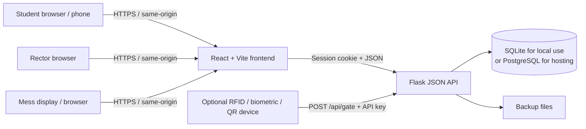
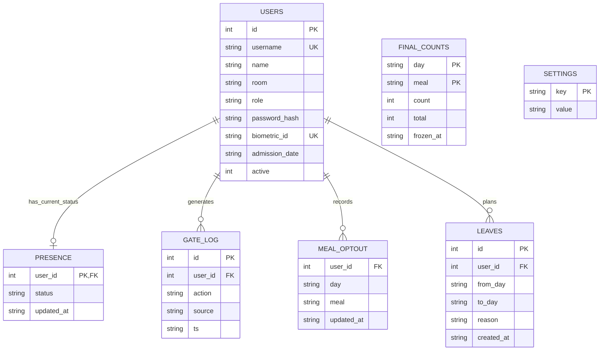

# MessMate architecture

## 1. What the system does

MessMate is a browser-based hostel attendance and meal-planning application. Students record meal choices and hostel presence; the rector monitors students and operations; mess staff use live meal counts to plan food. An optional gate device can update a student's presence using a biometric ID, username, RFID, or another identifier supplied by the device.

The application combines a React single-page frontend, a Flask JSON API, and a relational database. It can use SQLite for a local demo or PostgreSQL for a hosted deployment. The same backend serves the built frontend and API in the Docker/Gunicorn deployment.

## 2. Main components

| Component | Technology | Responsibility |
|---|---|---|
| Web client | React 19, Vite | Role-specific screens, meal planning, dashboards, charts, settings, and feedback |
| HTTP/API server | Python, Flask | Login/session handling, authorization, business rules, JSON endpoints, CSV export, and serving the built frontend |
| Database adapter | `db.py` | Selects SQLite or PostgreSQL, provides a shared connection interface, creates/upgrades the schema, and serializes data for backups/migration |
| Relational database | SQLite or PostgreSQL (including Supabase PostgreSQL) | Users, presence, meal choices, leave, settings, gate events, and frozen meal counts |
| Background scheduler | Python thread in the Flask process | Checks meal cut-off times every minute and creates/prunes backups hourly |
| Optional gate integration | HTTP JSON endpoint | Authenticates a device with `X-API-Key` and records a presence action |

The frontend is a single-page application with a small in-house router. It calls the Flask API using same-origin `fetch()` requests and JSON. In development, Vite runs on port 5173 and proxies `/api` requests to Flask on port 5000. For a standard deployment, Vite builds static files into `frontend/dist`, which Flask serves.

## 3. User roles and application areas

- **Student:** See current hostel status, mark lunch and dinner attendance for today or the next seven days, mark a planned leave, cancel eligible future leave, and mark going out, going home, or returning.
- **Rector:** View hostel presence and meal summaries, search and manage student accounts, correct a student's presence, inspect recent history, configure cut-off/curfew times, and manage/download backups.
- **Mess manager:** View a kitchen-oriented meal board, expected counts for tomorrow, and export frozen meal counts as CSV. The rector can also open the mess board.
- **Gate device:** Not a browser role. It uses a separate API-key-protected endpoint to identify an active student and set or toggle presence.

The frontend routes roles to their pages, but authorization is also enforced by Flask on protected API endpoints. A hidden page in the browser is not the security boundary.

## 4. Data model

The schema consists of seven tables:

- `users` stores student and staff identities, role, password hash, optional room/admission/biometric details, and an active flag. Deactivation is used instead of deleting an account.
- `presence` stores each student's latest status (`IN`, `OUT_DAY`, or `HOME`); it is not the movement history.
- `gate_log` stores presence events with action, source, and timestamp.
- `meal_optout` stores an explicit non-attendance choice for a particular student, date, and meal. No opt-out means the student is expected by default.
- `leaves` stores date ranges; an open-ended leave can represent a student who has gone home until returning.
- `final_counts` stores the frozen count and total active-student population for a date and meal.
- `settings` stores application-wide times such as lunch/dinner cut-offs and curfew.

User passwords are stored as Werkzeug password hashes, not as plaintext. The sample/import CSV is a provisioning input, not a runtime database. Sensitive student files should be handled only through an approved private channel and excluded from public repositories.

## 5. Meal-counting and attendance workflow

1. Each active student starts as expected for lunch and dinner unless an opt-out or leave applies.
2. The student changes a meal choice in the next-seven-day planner. Flask validates the date range, meal, choice, leave status, and whether the cut-off has passed before persisting the change.
3. Student, rector, and mess screens request summaries from Flask. The mess screen refreshes about every 15 seconds, the rector dashboard about every 30 seconds, and the student view about every 60 seconds. These are periodic refreshes, not a push/WebSocket feed.
4. Presence changes from the app, rector, or gate are written to `presence`; an event is also appended to `gate_log`.
5. Going out for the day does not cancel meals. Going home creates/maintains leave until the student returns, which cancels meals during that period.
6. After the configured cut-off, the backend freezes the current expected count in `final_counts`. The scheduler checks every minute; count requests also call the freeze logic, so a request after cut-off can trigger the freeze if the scheduler has not yet done so. A frozen count is shown instead of the live count.

The default cut-offs are lunch 10:30 and dinner 17:00; the default curfew is 21:00. They are configurable in the rector settings. The backend sets `TZ=Asia/Kolkata` where the operating system honors the `TZ` setting; on Windows, Python does not provide `tzset()`, so the host computer's time zone is used. Set the production host to India time and verify its clock before relying on cut-offs.

## 6. API surface

All API endpoints are under `/api`, including the gate endpoint. Frontend pages and static assets are served outside the API namespace.

| Area | Endpoint examples | Purpose |
|---|---|---|
| Authentication | `POST /api/login`, `POST /api/logout`, `GET /api/me`, `POST /api/password` | Establish/clear a session, load the current user, and change a password |
| Student | `GET /api/student`, `POST /api/student/meal`, `POST /api/student/gate`, `POST /api/student/leave`, `DELETE /api/student/leave/{id}` | Load a student's plan and update meal, presence, and leave |
| Rector | `/api/rector/dashboard`, `/api/rector/students`, `/api/rector/history`, `/api/rector/settings`, `/api/rector/backups` | Monitor and administer hostel operations |
| Mess | `GET /api/mess`, `GET /api/counts?day=YYYY-MM-DD`, `GET /api/export.csv` | View meal board/counts and download recent frozen counts |
| Gate integration | `POST /api/gate` | Set/toggle student presence after checking the configured device API key |

The browser session uses an HTTP-only cookie with `SameSite=Lax`; secure-cookie mode is configurable for HTTPS. API errors use HTTP status codes and a JSON `error` message. The optional gate endpoint instead authenticates with a shared `GATE_API_KEY`.

## 7. Database, backups, and data movement

### Database selection

- With `DATABASE_URL` or `DB_HOST` configured, the adapter uses PostgreSQL. A non-default `DB_SCHEMA` can isolate the application tables within a shared PostgreSQL database.
- Without PostgreSQL configuration, it uses the local `hostel.db` SQLite file (or `HOSTEL_DB` if supplied).
- The backend uses a common SQL interface so API/business logic can run against either database. Schema creation and additive upgrades run at application startup.

SQLite is convenient for local development and demonstrations. PostgreSQL is the intended hosted choice for concurrent users and managed operations.

### Backup and migration

- The application is configured to create one daily-named backup, refreshed hourly, and prune backups beyond the configured 30-day retention period.
- SQLite backups are database files; PostgreSQL backups are JSON dumps of the seven application tables.
- A rector can request a backup from the UI. The CLI can list, create, and restore backups.
- `migrate_to_postgres.py` copies data from the local SQLite database to configured PostgreSQL; the SQLite source remains unchanged.

Backup files are written to `BACKUP_DIR` (default `backups/`). A hosted environment must provide durable storage or an external backup destination if its local filesystem is ephemeral. A backup schedule alone does not demonstrate that restores have been tested.

## 8. Deployment topology

### Local/demo

Run Flask and Vite separately during development, or build the frontend and run the Flask app as a single local service. This is suitable for development, demonstrations, and small-scale evaluation.

### Hosted service

The repository includes a multi-stage Dockerfile: it builds the React app with Node, installs Python requirements, copies the built frontend into the Python image, and starts Flask through Gunicorn. The provided Gunicorn configuration uses one worker and eight threads; its worker startup starts the in-process scheduler.

For a hosted rollout, use HTTPS, PostgreSQL, durable backup storage, managed secrets, and operational monitoring. The scheduler is a background thread in the web process; do not scale the web service to multiple independent scheduler processes without moving scheduling to a single dedicated worker or external scheduler.

The repository also contains Vercel routing configuration and a serverless API entry point. The current hourly backup/cut-off scheduler is started by the local/Gunicorn startup paths, not by that serverless entry point. Therefore Vercel's presence in the repository should not be presented as proof that scheduled backups run there.

## 9. Important current scope and rollout considerations

### One hostel per deployment today

The current schema has no `hostel`, `organization`, or `tenant_id` entity. Settings, student queries, meal counts, and staff roles all operate on the entire database. The application is therefore **single-hostel per deployment/database** today.

For an initial rollout to several hostels, use a separately configured deployment and database/schema for each hostel. This provides a clear operational boundary but requires separate administration and upgrades. A shared multi-hostel SaaS deployment would require a tenant model and tenant-scoped authorization and queries throughout the application, including users, settings, leave, meal counts, gate identities, exports, backups, and admin functions. A tenant selector alone would not provide data isolation.

### Operational/security checklist before live use

- Replace the development `SECRET_KEY` and placeholder `GATE_API_KEY`; do not use demo/bootstrap passwords for real accounts.
- Enforce HTTPS and enable secure session cookies in production.
- Protect student personal data, credentials, database access, gate-device credentials, and backup files; define access, retention, and recovery procedures with each hostel.
- Confirm that the hosting plan provides persistent database and backup storage and that a restore has been tested.
- Monitor application errors, database connectivity, scheduled jobs, and backup completion.
- Validate gate-device identity/action mapping and the network path before connecting physical access-control equipment.
- Complete a security/privacy review and load test against the actual deployment and expected hostel population. This document describes architecture; it is not a security certification or capacity guarantee.

## 10. Short presentation summary

> MessMate replaces manual meal headcounts with a shared web workflow. Students plan meals and leave, hostel staff monitor presence, and mess staff see live expected counts with a frozen count at each meal cut-off. A Flask API applies the rules and stores the operational data in SQLite for demos or PostgreSQL for hosting. The current release is designed for one hostel per deployment; each hostel can have its own isolated deployment, while a future shared platform would need explicit tenant-level data isolation.
